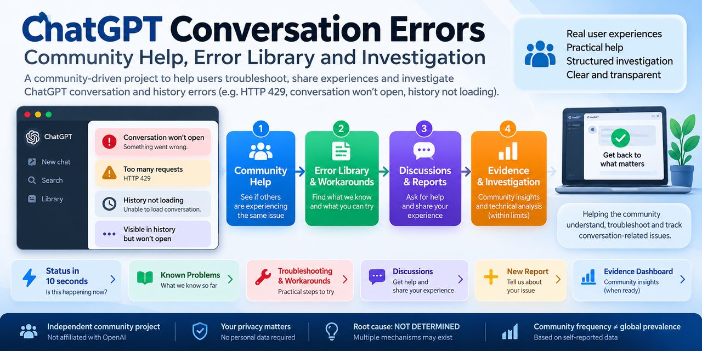

# ChatGPT Historical Chats / Conversations Failing to Open

> **Need help quickly?** [10-second status](STATUS.md) · [Community Help](HELP.md) · [Known Problems](docs/known-problems.md) · [Workarounds](docs/workarounds-and-solutions.md) · [Discussions](https://github.com/gmot-bot/chatgpt-conversation-429-investigation/discussions) · [New report](https://github.com/gmot-bot/chatgpt-conversation-429-investigation/issues/new/choose) · [GitHub in 60 seconds](docs/github-for-beginners.md)

## Community status — 10-second view

**[Are others reporting this? What do we know? Is there a workaround? Is it resolved? Where do I get help? → STATUS](STATUS.md)**

Browse: [Known Problems](docs/known-problems.md) · [By error](docs/index-by-error.md) · [By platform](docs/index-by-platform.md) · [Evidence Dashboard](docs/evidence-dashboard.md) · [Official OpenAI status context](docs/official-status-context.md)

## HTTP 429, Conversation Retrieval and Realtime Recovery — An Independent Technical Investigation

**Status:** Active investigation  
**Root cause:** **NOT DETERMINED**

## Community Operations

V4.5 adds a bounded [Contribution Pipeline](docs/community-operations.md), [Latest Community Changes](docs/latest-changes.md), [Triage Ledger](docs/triage-ledger.md), [Deduplication Protocol](docs/deduplication-protocol.md), and [Aggregate Readiness Gate](docs/aggregate-readiness.md). Automatic rules may surface **candidates only**; they never establish causality.

## Community Help Centre

**Non-technical visitor?** Open the [Community Help Centre](docs/community-home.md): find your error, see what is known, check safe workarounds, find similar reports, ask the community, or learn GitHub in 60 seconds.

- [Current error status](docs/chatgpt-error-status.md) | [Workarounds & Solutions](docs/workarounds-and-solutions.md) | [Other people are seeing this](docs/people-are-seeing-this.md)
- [Did this help?](docs/did-this-help.md) | [GitHub in 60 seconds](docs/github-for-beginners.md) | [Community Intelligence](docs/community-intelligence.md)

## Need help? No technical knowledge required

If a ChatGPT conversation will not open, your history is not loading, or you see an error message, start with **[Community Help](HELP.md)**. Use the [Error & Problem Library](docs/error-library.md) to find your symptom, read safe steps, compare similar reports, or ask the community.

This is an **unofficial community project**. It cannot access your ChatGPT account or replace OpenAI Support. You do not need to publish technical logs to ask for help.

## Quick start

**ChatGPT conversations not loading?** If you are seeing `HTTP 429`, `Too many requests`, `Couldn't load this ChatGPT conversation`, a chat that remains visible/searchable but will not open, or repeated retry/refetch/recovery behaviour, start with [START-HERE.md](START-HERE.md).

- Affected user: [Safe troubleshooting](TROUBLESHOOTING.md) | [FAQ](docs/faq.md) | [Known errors/search phrases](docs/known-error-messages.md)
- Engineer/researcher: [Reproduction matrix](docs/reproduction-matrix.md) | [H0-H12 evidence framework](docs/evidence-quality-hypothesis-matrix.md) | [Engineering decision tree](docs/engineering-decision-tree.md)
- Contributor: use **Simple problem report** for a basic report or **Independent reproduction** for technical evidence. Never publish private identifiers or generate repeated traffic to reproduce the problem.

## Discoverability V3

- [Public report triage](docs/discoverability-v3-report-triage.md) adds discriminating reports and counterexamples without inflating the causal claim.
- [Discussions guide](docs/discussions-guide.md) defines safe community entry points.
- [Release baseline](docs/release-notes-v0.3.0.md) makes the current evidence/engineering state citable.
- [Social preview specification](docs/social-preview-spec.md) is ready for a later repository-image UI action.

## Purpose
This repository documents a persistent reliability problem in which existing or historical ChatGPT chats/conversations may remain visible or searchable but fail to open normally.

In the maintainer's investigated case, the user-visible failure has been accompanied by repeated HTTP 429 responses during conversation retrieval and observable realtime subscription/recovery behaviour. These observations are documented because they may help identify the failure mechanism; **correlation is not presented as causation**.

The investigation deliberately starts from the user-visible symptom — historical conversations failing to open — rather than assuming that HTTP 429, WebSockets, realtime recovery, rate limiting, account state, or any other component is the root cause.

The goals are to document the behaviour accurately, find genuinely independent reports and reproductions, distinguish related symptoms from evidence of a common mechanism, identify safe mitigations, and help the community and OpenAI Support/Engineering converge on a definitive explanation and resolution.

## Good-faith statement
This is not an advocacy, criticism, or reputational campaign against OpenAI. References to OpenAI and ChatGPT are limited to what is reasonably necessary to identify and investigate the affected product and behaviour.

The maintainer uses ChatGPT extensively, intends to remain a customer, and has repeatedly engaged OpenAI Support in an effort to diagnose and resolve the problem. Publishing this investigation is intended to complement — not replace — that private support process.

## About the maintainer
The maintainer is a long-term ChatGPT customer and an amateur enthusiast of coding, web design and technology.

He is not affiliated with OpenAI. This repository is a good-faith attempt to contribute constructively by inviting technically rigorous independent observations, reproductions, explanations and safe mitigation ideas from the wider community.

## User-visible symptom
The core symptom is simple: an existing/historical conversation can remain present in ChatGPT history, search or a project while failing to open normally.

This repository separates that symptom from the technical mechanisms that may accompany it.

## Evidence taxonomy
- **S0 — User symptom:** an existing/historical chat fails to open.
- **S1 — Application behaviour:** the conversation remains visible/searchable but retrieval/opening fails.
- **S2 — Network evidence:** a conversation/history retrieval request returns HTTP 429 or another demonstrated failure.
- **S3 — Mechanism evidence:** realtime/recovery/subscription/refetch behaviour is observed and temporally correlated with retrieval activity.

A similar S0 symptom is not automatically classified as reproduction of the same root cause.

## Confirmed observations in the investigated case
- Persistent HTTP 429 responses were observed during conversation/history retrieval.
- Backoff-related response headers were observed, including `Retry-After` and `X-Oai-History-Initial-Retry-After` in preserved evidence.
- A realtime WebSocket connection could establish successfully while conversation/history retrieval was failing.
- `conversation-update` / `refetch-conversation` events were observed.
- In observed client-side traces, a realtime/recovery path was capable of initiating conversation-detail retrieval.
- More than one occurrence of the same relevant recovery-linked request family was observed.

These observations do **not** establish the final root cause.

## What the evidence does not establish
The available client-side evidence does not prove that every realtime broadcast causes a separate HTTP request, that multiple WebSocket subscriptions cause the HTTP 429 responses, that client-side deduplication is defective, that the server is closing sockets, or that a particular rate-limit bucket/account/history state is the primary cause.

Those questions require stronger evidence, including server-side telemetry where applicable.

## Working hypotheses
| Hypothesis | Current status |
|---|---|
| Conversation/history retrieval is affected by HTTP 429 | OBSERVED |
| Realtime can remain connected while history retrieval fails | OBSERVED |
| `refetch-conversation` occurs during the investigated condition | OBSERVED |
| A recovery path can initiate conversation retrieval | OBSERVED client-side |
| Multiple recovery paths amplify equivalent requests | UNCONFIRMED |
| Insufficient coalescing/deduplication contributes | UNCONFIRMED |
| Account/history server state contributes | UNCONFIRMED |
| Rate limiting is the primary root cause | NOT DETERMINED |
| WebSocket/realtime behaviour is the primary root cause | NOT DETERMINED |
| Final root cause | NOT DETERMINED |

## Safe reproduction and observation policy
Do **not** intentionally generate repeated failing requests, automate retries, bypass rate limits, or create additional traffic merely to reproduce this investigation. Naturally occurring evidence is preferred.

If a `Retry-After` value is present, respect it. Contributors should not publish credentials, cookies, authentication material, account/user identifiers, conversation identifiers, request identifiers, IP addresses, precise locations or unrelated conversation content.

## Independent and related reports
Reports from other users may be classified as a related symptom report, independent symptom reproduction, independent HTTP reproduction, or mechanism reproduction depending on the evidence supplied. Agreement between several users does not by itself establish a common root cause.

**Common root cause: NOT DETERMINED.**

## Independent public reports
Verified independent reports and technically inspected reproductions are catalogued in [docs/independent-public-reports.md](docs/independent-public-reports.md). Similar symptoms and HTTP 429 observations increase investigative confidence that the failure class is not unique to this maintainer; they do not establish a common root cause.

## Reproduction matrix and scale hypothesis
A conservative cross-report evidence matrix is maintained in [docs/reproduction-matrix.md](docs/reproduction-matrix.md). A separate [system-scale hypothesis](docs/system-scale-hypothesis.md) asks whether correlated recovery/refetch amplification across many simultaneous clients could materially increase aggregate service load. This is explicitly a **HYPOTHESIS**, not a claim that a global overload or cascading failure has occurred.

## OpenAI Support status
OpenAI Support has been contacted on multiple occasions and has received additional diagnostic information privately. This public repository intentionally omits private case identifiers, private correspondence and correlation identifiers. A public-safe engineering escalation companion is maintained in [docs/openai-engineering-escalation.md](docs/openai-engineering-escalation.md); identifying correlation material remains private.

## Privacy and evidence integrity
Public artefacts are privacy-minimised derivatives created specifically for publication. Sensitive forensic originals and private Engineering derivatives are retained separately and are not part of this repository.

Absolute timestamps and unique identifiers may be removed from public artefacts. Where relative labels are used, they are explicitly presented as privacy transformations rather than original evidentiary values. No transformed value is represented as an unmodified original.

## Corrections are part of the investigation
If stronger evidence contradicts a statement or hypothesis in this repository, the repository should be corrected rather than defended. Confirmed observations, independent reproductions, inferences, hypotheses and unknowns are deliberately maintained as distinct epistemic categories. The current consolidated boundary is recorded in [docs/final-epistemic-review.md](docs/final-epistemic-review.md).

## Contributing
Technical disagreement is welcome. Unsupported certainty is not. Please read `CONTRIBUTING.md`, `EVIDENCE_POLICY.md` and `PRIVACY.md` before submitting evidence.

## Scope and non-affiliation
This is an independent community investigation. It is not an OpenAI project and is not endorsed by OpenAI. OpenAI and ChatGPT are referenced only as necessary to identify the affected product. No negligence, misconduct, intentional throttling, defective design or specific root cause is alleged without evidence.

## Troubleshooting and engineering guide
For a compact public-safe guide covering common search phrases, safe first actions, known mitigation boundaries, falsifiability criteria and high-value Engineering questions, see [docs/discoverability-and-engineering-guide.md](docs/discoverability-and-engineering-guide.md).

This guide is deliberately diagnostic rather than prescriptive: similar UI symptoms can arise from distinct mechanisms, and **root cause remains NOT DETERMINED**.

## Repository discoverability
Search/discovery wording and proposed repository metadata are documented in [docs/repository-discoverability-plan.md](docs/repository-discoverability-plan.md). Topics and search phrases are treated as navigation aids, not as evidence of causation.

## Community participation
Use **Issues** for structured independent reproductions and **Discussions** for questions, related experiences, hypotheses and evidence interpretation that do not yet meet the issue evidence gate. See [docs/community-participation.md](docs/community-participation.md) for privacy, safety and notification guidance.

## Evidence quality and competing hypotheses

See [Evidence Quality, Hypotheses and Engineering Test Matrix](docs/evidence-quality-hypothesis-matrix.md) for the public-safe evidence framework, H0-H12 registry, failure taxonomy, falsification tests, conditional mitigations, observability wishlist and privacy-preserving contribution protocol. Root cause remains **NOT DETERMINED**.

## Engineering decision tree

The [evidence-to-hypothesis map and engineering decision tree](docs/engineering-decision-tree.md) maps existing public evidence to H0-H12, identifies discriminators and falsifiers, and prioritizes telemetry that could resolve competing explanations without additional public disclosure.

## Community entry points

- [Start here - affected users](https://github.com/gmot-bot/chatgpt-conversation-429-investigation/discussions/1)
- [HTTP 429 / Too Many Requests - technical evidence](https://github.com/gmot-bot/chatgpt-conversation-429-investigation/discussions/2)
- [Safe troubleshooting and mitigations](https://github.com/gmot-bot/chatgpt-conversation-429-investigation/discussions/3)
- [Hypotheses and engineering analysis](https://github.com/gmot-bot/chatgpt-conversation-429-investigation/discussions/4)

Use Discussions for exploratory/community material and Issues for structured reproductions. See [the Discussions guide](docs/discussions-guide.md) before posting.
