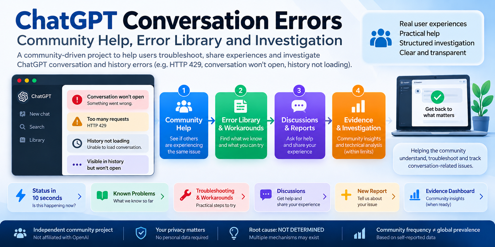

# Community Status — 10-Second View

> **Unofficial community project. Last project review: 2026-10-17.** See [Latest Community Changes](docs/latest-changes.md).

## Are other people reporting this?

**YES — for several conversation/history failure families.** See [Known Problems / Recently Reported](docs/known-problems.md). This means similar public observations exist; it does **not** mean all reports have the same cause or measure ChatGPT-wide prevalence.

## What do we know?

- Some independent public reports directly show HTTP 429 during conversation/history retrieval.
- Some show overlapping or automatic retrieval/refetch/recovery activity.
- Similar visible symptoms can also occur without a demonstrated 429.
- Root cause across all cases: **NOT DETERMINED**.

## Is there a workaround?

There is **no universal confirmed fix**. Safe practices and bounded reported workarounds are indexed in [Workarounds & Solutions](docs/workarounds-and-solutions.md).

## Is it resolved?

**Not as one universal problem.** Individual incidents and individual users may recover, while the broader evidence set still contains multiple unresolved mechanisms.

## Where do I get help?

[Community Help](HELP.md) → [Error Library](docs/error-library.md) → [Ask the community](https://github.com/gmot-bot/chatgpt-conversation-429-investigation/discussions/1)

## Official OpenAI service status

Use the [official OpenAI Status page](https://status.openai.com/) for incidents acknowledged by OpenAI. Official incidents are authoritative for their stated scope, but temporal proximity does not prove they caused a particular community report.
